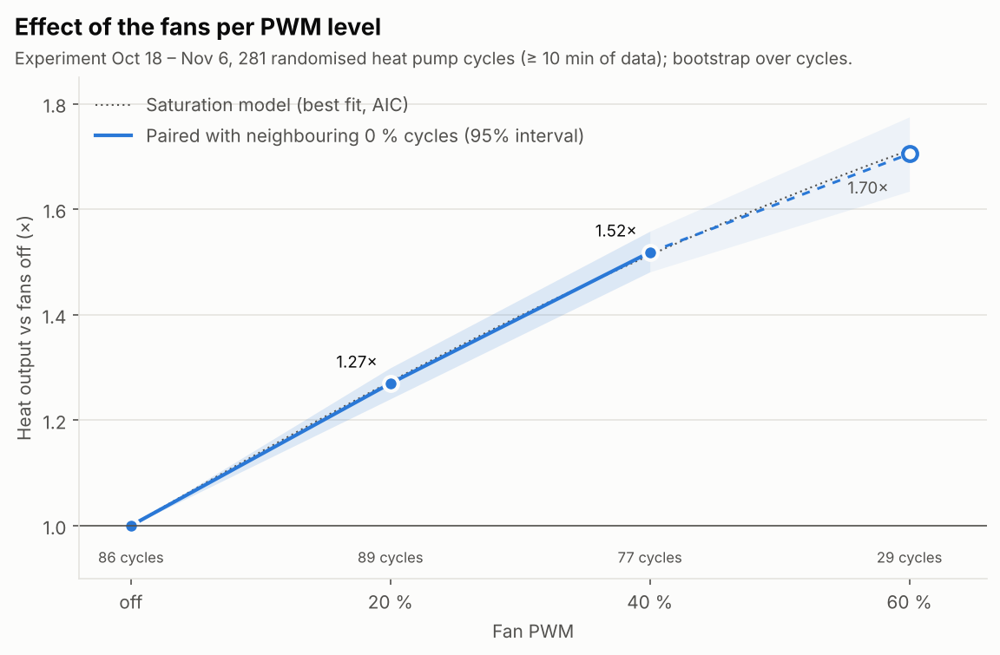
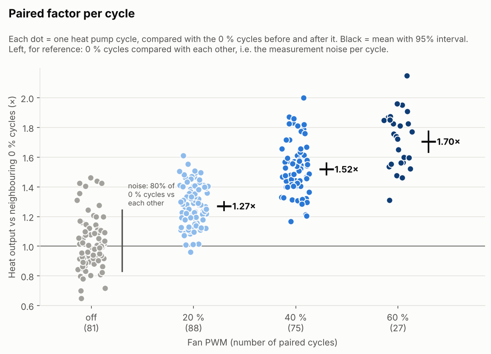

# RadiatorFan for ESPHome

ESPHome firmware for an ESP32 that drives PWM fans on a hydronic radiator. Fans blowing
along a radiator raise its heat output a lot, which matters with a heat pump: the same heat
at a lower water temperature means a better COP.

The firmware

- drives 4-pin PWM fans (25 kHz) and reads the tachometer;
- measures the radiator supply and return temperature with two DS18B20 sensors;
- runs an automatic controller based on how warm the radiator is compared with the room;
- switches the fans off during a heat pump defrost (signal from Home Assistant);
- recovers stuck DS18B20 sensors by power-cycling them from a GPIO;
- has an optional **experiment mode** to measure how much extra heat each fan speed gives;
- has a web interface, so it also works without Home Assistant.

Developed on a vertical type 22 radiator (2200 × 700 mm) with 4 × Arctic P9 PWM PST and an
ESP32-DevKitC (38 pins), heated by a Remeha Confida air-to-water heat pump.

## Hardware

| Part | Notes |
|---|---|
| ESP32 dev board | Tested on an ESP32-DevKitC 38-pin clone |
| 4-pin PWM fans | Tested with Arctic P9 PWM PST (12 V, 0.12 A, 200-3000 rpm, 0 rpm below ~5 % PWM) |
| 12 V power supply | Sized for the fans |
| 2 × DS18B20 | On the supply and return pipe of the radiator, plus a 4.7 kΩ pull-up resistor |
| 10 kΩ resistor (optional) | External pull-up for the tachometer line |

### Wiring (default pins)

| Function | GPIO | Notes |
|---|---|---|
| Fan PWM (fan pin 4) | GPIO25 | 25 kHz |
| Fan tachometer (fan pin 3) | GPIO26 | internal pull-up; add 10 kΩ to 3.3 V if the reading is unstable |
| DS18B20 data | GPIO27 | 4.7 kΩ pull-up to 3.3 V |
| DS18B20 VDD | GPIO14 | sensors powered from a GPIO (~3 mA) so the ESP can power-cycle them |

- Connect the ground of the 12 V supply to the ground of the ESP32.
- Let the fan current return directly to the power supply, not through the ESP board, and keep
  the 1-Wire cable away from the PWM and 12 V wires. A 100 nF capacitor between VDD and GND at the
  sensors helps.
- Never use GPIO6-11 (internal flash).
- Some cheap 38-pin boards have a pin labelled GND that is not connected. Check with a multimeter.
- All pins can be changed with the `pin_*` substitutions.

With several fans on one PWM line, connect the tachometer wire of only one fan.

## Installation

1. Copy [`esphome/example.yaml`](esphome/example.yaml) into your ESPHome config folder, for example as
   `radiatorfan1.yaml`.
2. Put `wifi_ssid` and `wifi_password` in your `secrets.yaml` (see
   [`secrets.yaml.example`](esphome/secrets.yaml.example)).
3. Set the substitutions (below) and flash.
4. Find the DS18B20 addresses in the boot log (`gpio.one_wire: 0x... (DS18B20)`), warm one sensor
   with your hand to see which is which, put them in `addr_supply` and `addr_return` and flash again.

The example pulls the full configuration ([`esphome/radiatorfan.yaml`](esphome/radiatorfan.yaml)) from
this repository as a package (`url:` in the example must point to this repository). You can also copy that file and edit it directly. For more radiators,
make one device file per ESP.

After flashing over the air, wait at least 60 s before removing power. Otherwise the bootloader rolls
back to the previous firmware. The `Firmware build` sensor shows which build is running.

### Substitutions

| Substitution | Required | Default | Meaning |
|---|---|---|---|
| `name`, `friendly_name` | yes | | Device name |
| `addr_supply`, `addr_return` | yes | | 1-Wire addresses of the DS18B20s |
| `ha_room_temp` | no | `sensor.living_room_temperature` | Room temperature near the radiator |
| `ha_thermostat` | no | `climate.living_room` | Thermostat; its `temperature` attribute is the setpoint |
| `ha_defrost` | no | `binary_sensor.heat_pump_defrost` | Heat pump defrost on/off |
| `ha_compressor` | no | `binary_sensor.heat_pump_compressor` | Compressor running on/off (experiment mode only) |
| `pin_pwm`, `pin_tach`, `pin_onewire`, `pin_ds_power` | no | 25, 26, 27, 14 | GPIO numbers |
| `exp_night_start`, `exp_night_end` | no | 23, 6 | Night window of the experiment mode (hours) |

The on/off entities can be a `binary_sensor` (`on`/`off`) or a numeric sensor (`1`/`0`).

### Without Home Assistant (or without some entities)

Missing entities are simply ignored:

- no room temperature: the controller assumes 20 °C;
- no thermostat: the "room at setpoint" rule is skipped;
- no defrost signal: the fans keep running during a defrost;
- no compressor signal: the experiment mode never starts a cycle.

Example for a Remeha Confida read over Bluetooth with the
[`remeha_ble`](https://github.com/mcc-tweakers/esphome-remeha-ble) component:

```yaml
  ha_room_temp: sensor.remeha_confida_ruimtetemperatuur_van_de_groep_cm030
  ha_thermostat: climate.zone1
  ha_defrost: binary_sensor.remeha_confida_bu_ontdooimodus_in_werking_hm009
  ha_compressor: binary_sensor.remeha_confida_warmtepomp_compressor_aan_uit_hm008
```

## Automatic control (every 5 s)

1. **Defrost** active: fans off.
2. **Radiator temperature**: fans on when supply ≥ room + *Start at supply above room* (default
   5 K), off again below that value minus 2 K (hysteresis).
3. **Proportional**: from *Auto min PWM* at the start threshold to *Auto max PWM* at supply = room
   + *Max PWM at supply above room* (default 15 K).
4. **Room at or above setpoint**: back to *Auto min PWM*.
5. **Ramp**: at most 1 %-point per 5 s up or down; switching off is immediate.

All thresholds are `number` entities, adjustable in the web interface and in Home Assistant. Mode
*Manual* uses the *Manual PWM* slider (0 % = off). The *Fan control* sensor tells you why the fans do
what they do.

### Stuck DS18B20 sensors

If a DS18B20 gives no reading for more than 60 s, the ESP powers the sensors off for 2 s (at most once
per 5 min) and counts this in *DS18B20 power cycles*. Both VDD (GPIO14) **and** the data line
(GPIO27) are pulled low: with only VDD low, a DS18B20 keeps running on parasite power from the data
line. *Radiator sensor fault* turns on when a sensor has had no reading for 60 s.

## Experiment mode (Fan mode = "Experiment")

Measures the heat output per fan level compared with fans off. The ESP only does the **design**
(randomised levels); the **analysis** is done afterwards on the Home Assistant history.

- Every **heat pump cycle** gets a random fixed level from 0/20/40/60 % (shuffled bag, so the levels
  stay balanced). A cycle starts at the **end of a defrost** or a **compressor start** and ends at
  the **start of a defrost** or a **compressor stop**. Between cycles the automatic controller runs.
- 60 % (above *Auto max PWM*) is only used in the night window (23:00-06:00 by default); during the
  day it is skipped and kept for later. During a defrost the fans are always off.
- A compressor stop, a reboot or a short cycle only costs that piece of data. *Experiment cycle* logs
  the start and end of each cycle (time, level, cause).

### Example result

Three weeks of experiment mode on the radiator above (281 heat pump cycles, October-November 2026).
Each cycle with the fans on was compared with the 0 % cycles just before and after it, so slow changes
in weather and house drop out.

| Fan PWM | Heat output vs fans off | 95% interval |
|---|---|---|
| 20 % | 1.27× | 1.24-1.30 |
| 40 % | 1.52× | 1.48-1.56 |
| 60 % | 1.70× | 1.63-1.78 |





Every step up gives more heat, but the gain per step gets smaller. The relative effect is somewhat
smaller with warmer water. Heat output per cycle was estimated from an energy balance (flow × radiator
ΔT against radiator-minus-room temperature), so these numbers apply to this radiator and setup.

## License

MIT, see [LICENSE](LICENSE).
